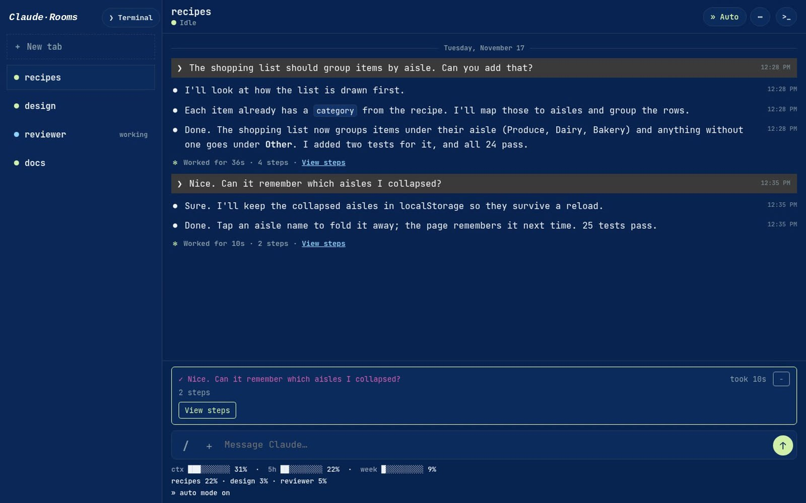
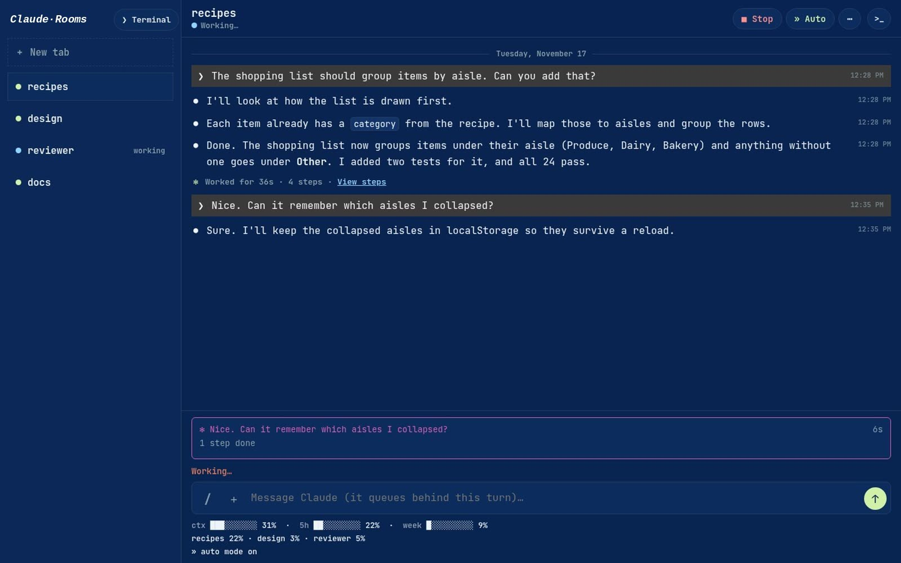
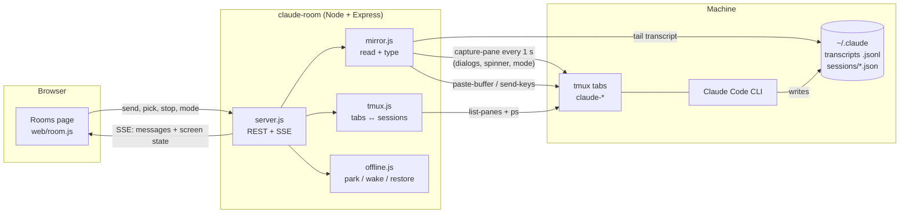

# Claude Rooms

**Claude Code chat rooms in the browser.** Every tmux tab running Claude Code shows up as a room. Open one on a phone or laptop and it is the same live session the terminal shows: type on either side, answer Claude's questions with a tap, approve plans, stop a turn, switch mode or model, close a room and wake it later.

It doesn't use a second agent or the SDK. The page is a second window onto the real CLI.

| A room after two turns | Mid-turn: steps box, Stop, queued input |
|---|---|
|  |  |

<sub>Screenshots use made-up demo data.</sub>

## Built with Claude Code

This whole project was written by Claude Code sessions in a terminal, following a written rulebook. The owner set the direction and reviewed every change. The `docs/` folder shows how:

- **[RULES.md](docs/RULES.md)**: the rules Claude worked under (confirm before destructive actions, never restart the live service mid-task, test on a separate copy, back up before DB edits, …) and the incidents behind them.
- **[PRACTICES.md](docs/PRACTICES.md)**: how changes were tested (e2e scripts on a `:4631` test copy), reviewed and shipped.
- **[HANDOFFS.md](docs/HANDOFFS.md)**: how rooms pass work to each other in a fixed format the page draws as cards.
- **[BUILD-LOG.md](docs/BUILD-LOG.md)**: dated history of the main features.

## How it works



- **Rooms** are tmux sessions named `claude-<name>` with `claude` running inside. `tmux.js` matches each to its session through the CLI's own `~/.claude/sessions/<pid>.json`.
- **Reading**: the session transcript (`.jsonl`) is tailed for messages. The tmux screen is captured every second for what only the screen knows: a dialog's numbered options, the spinner, the mode line and the status line.
- **Writing**: text is pasted into the pane (bracketed paste, so newlines survive), and dialog options are picked by number. Exactly what a person at the keyboard would press.
- **Offline / Wake**: closing a room remembers it. Waking it runs `claude --resume <id>` in its own folder with its own flags. Open rooms are snapshotted every 30 s, and come back by themselves after a reboot.
- **Unread**: the server reports when each room last replied, and the page compares that with when you last looked.

## Run it

You need Linux or macOS, **tmux**, **Node 20.12+**, and the **Claude Code** CLI signed in.

```sh
git clone https://github.com/dbenson457/claude-rooms && cd claude-rooms
npm install --omit=dev
cp .env.example .env        # optional: every setting has a default
npm start                   # http://127.0.0.1:4630
```

Start a room from the page (**＋ New tab**), or from a terminal:

```sh
tmux new -s claude-myproject   # then run: claude
```

**Optional: question cards built from the real question.** Claude only writes a question to the transcript after it's answered. A small hook saves it as it's asked, so the page can draw previews properly. Add this to `~/.claude/settings.json`:

```json
{ "hooks": { "PreToolUse": [ { "matcher": "AskUserQuestion",
  "hooks": [ { "type": "command", "command": "node /path/to/claude-rooms/ask-hook.mjs" } ] } ] } }
```

**Optional: `bin/room-wake <name>`** lets one session wake an offline room before handing it work (see [HANDOFFS.md](docs/HANDOFFS.md)).

### Security

Whoever can reach this page can drive Claude on your machine. By default it listens on and answers only `127.0.0.1`. To use it from a phone, put it behind a reverse proxy **with its own login** (or a private network such as a VPN), and list only that proxy in `ROOM_ALLOW`.

### Configuration

All settings are environment variables. [`.env.example`](.env.example) lists each one with a comment: port and listen addresses, allowed clients, Claude's folder, the starting folder for new tabs, tabs to hide, an optional home dashboard that embeds the page, a web terminal link, and the pinned assistant room's flags.

## Layout

```
server.js      HTTP API + server-sent events, reboot restore
mirror.js      reads the tab (screen + transcript), types into it
tmux.js        tmux tabs ↔ Claude sessions, cached
offline.js     closed rooms, wake, live snapshot
commands.js    "/" commands: built-ins + your skills
five.js        5-hour usage samples (optional)
config.js      settings from the environment
ask-hook.mjs   PreToolUse hook for question cards
web/           the page (plain JS + CSS, no build step)
tests/         Playwright e2e scripts for a test copy
bin/room-wake  wake an offline room by name
docs/          how it was built
```

## Licence

[MIT](LICENSE)
